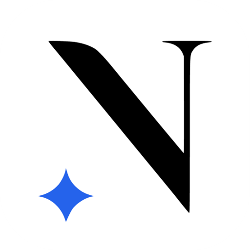
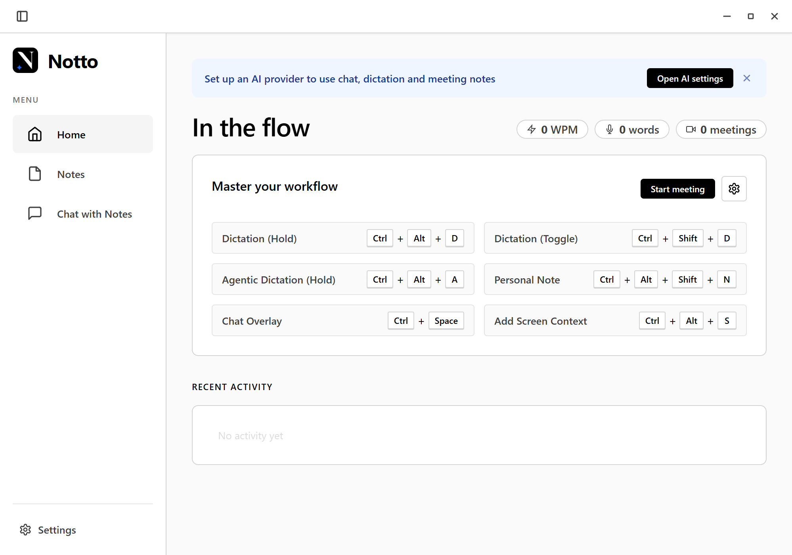
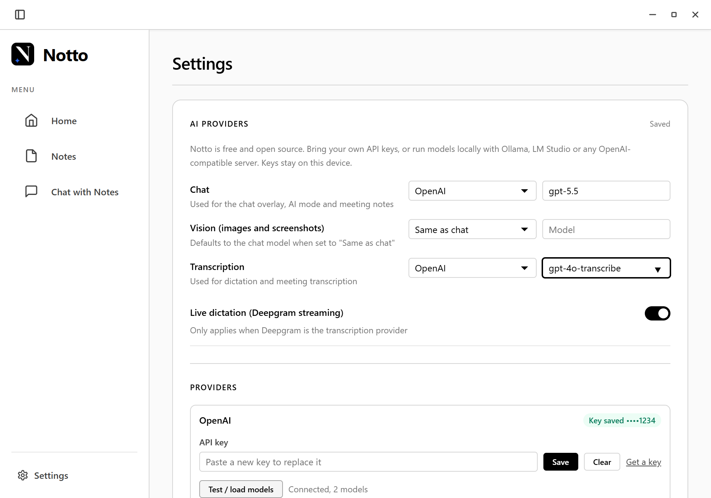
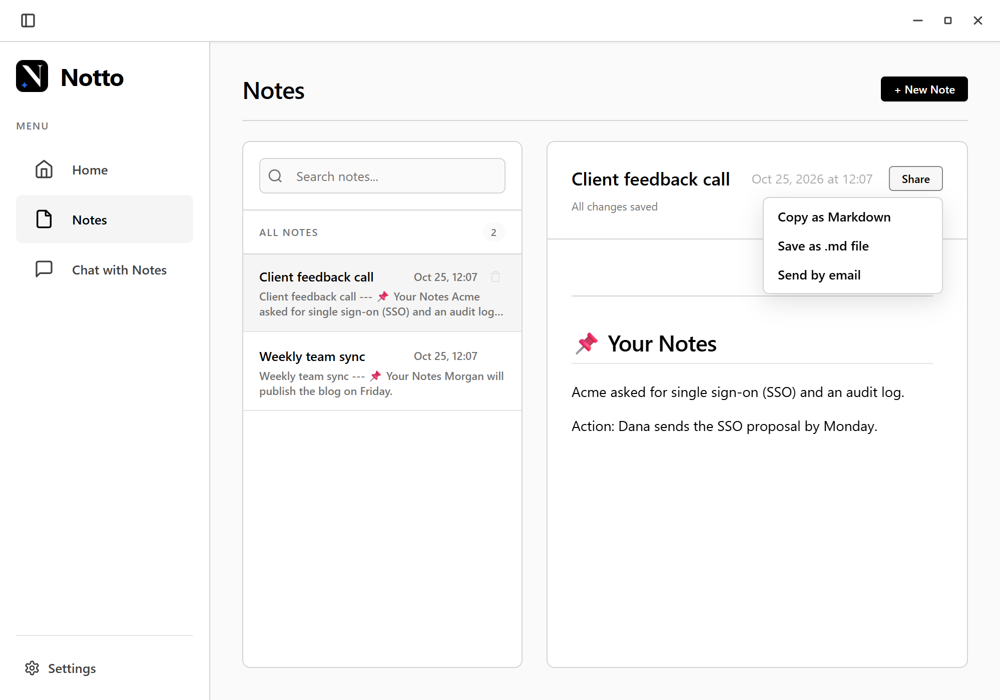

<div align="center">



# Notto

**Free, open-source AI notes, dictation and meeting assistant for your desktop.**<br>
Bring your own API keys, or run everything locally. No account, no subscription, no cloud.

[](https://github.com/matei-anghel/notto/releases/latest/download/Notto-Setup.exe)
&nbsp;
[](https://github.com/matei-anghel/notto/releases/latest)
&nbsp;
[](LICENSE)



</div>

## What it does

| | |
|---|---|
| 🎙️ **Dictation anywhere** | Hold or toggle a shortcut, speak, and the text is typed into whatever app you're using. |
| ✨ **AI mode** | Speak a request ("reply to this politely") and Notto writes it for you, using your screen as context. |
| 💬 **Chat overlay** | An always-on-top chat that understands screenshots, PDFs, Word and Excel files, and your notes. It can be hidden from screen sharing. |
| 📝 **Meeting notes** | Records your microphone and computer audio in any meeting app, then writes a summary with decisions and action items. No bot joins your call. |
| 🧠 **Chat with your notes** | Ask a question and Notto finds the answer across your past meetings and notes, with links to its sources. |
| 📤 **Share meeting notes** | Copy as Markdown, save a `.md` file, or open an email with the notes in one click. |
| 🗒️ **Quick notes** | A floating notepad that's always one shortcut away. |

## Bring your own AI

Pick a model for chat, an optional one for screenshots and images, and one for transcription in **Settings → AI Providers**. Keys are encrypted with your operating system's keychain and never leave your computer except to talk to the provider you chose.

| Provider | Chat | Transcription |
|---|:---:|:---:|
| OpenAI | ✓ | ✓ |
| Anthropic (Claude) | ✓ | |
| Google Gemini | ✓ | |
| OpenRouter | ✓ | |
| Groq | ✓ | ✓ |
| Mistral | ✓ | ✓ |
| DeepSeek, xAI, Fireworks, Cerebras, Perplexity | ✓ | |
| Together AI | ✓ | ✓ |
| Deepgram | | ✓ (incl. live streaming) |
| **Ollama, LM Studio** (local) | ✓ | |
| **Any OpenAI-compatible server** (vLLM, llama.cpp, LocalAI, speaches…) | ✓ | ✓ |

**Fully offline:** use Ollama or LM Studio for chat and a local Whisper server such as [speaches](https://github.com/speaches-ai/speaches) for transcription, and nothing leaves your machine.

<div align="center">

&nbsp;

</div>

## Install

**Windows:** download **[Notto-Setup.exe](https://github.com/matei-anghel/notto/releases/latest/download/Notto-Setup.exe)** and run it. The installer isn't code-signed yet, so Windows SmartScreen may ask you to confirm: choose *More info → Run anyway*.

**macOS and Linux:** [build from source](#build-from-source) for now. The code supports both, and installers will follow in later releases.

After installing, open **Settings → AI Providers**, add a key (or point Notto at a local model server), and choose your models.

## Keyboard shortcuts

| Action | Windows / Linux | macOS |
|---|---|---|
| Dictate while holding | `Ctrl` `Alt` `D` | `⌘` `⌥` `D` |
| Start / stop dictation | `Ctrl` `Shift` `D` | `⌘` `⇧` `D` |
| AI mode while holding | `Ctrl` `Alt` `A` | `⌃` `⌥` `A` |
| Chat overlay | `Ctrl` `Space` | `⌥` `Space` |
| Add a screenshot to the chat | `Ctrl` `Alt` `S` | `⌘` `⌃` `S` |
| Quick notes | `Ctrl` `Alt` `Shift` `N` | `⌘` `⌃` `⇧` `N` |

Every shortcut can be changed or turned off in Settings.

## Privacy

- Notes, transcripts, chat history and recordings are stored only on your computer, in `~/notto/electron/userData`.
- Notto sends data only to the AI providers you configure, and only when you use a feature that needs them.
- No account, analytics or telemetry. The only other network request is the update check against this repository's releases.

## Build from source

You need Node.js 22.13 or newer. No C++ toolchain is required, because native modules ship prebuilt binaries.

```bash
git clone https://github.com/matei-anghel/notto.git
cd notto
npm install
npm start          # build and run in development
npm test           # unit tests
npm run dist       # create an installer for your platform in release/
```

Optional native helpers let Notto notice when a meeting app starts using the microphone. Build them with `npm run build:win-helper` (needs the .NET 8 SDK) or `npm run build:mac-helper` (needs the Xcode command line tools). Everything else works without them.

<details>
<summary>Project layout</summary>

```
src/main.ts           Electron main process: windows, tray, shortcuts, lifecycle
src/main/ai/          Provider client (OpenAI-compatible, Anthropic, Deepgram), key store, prompts
src/main/*Ipc.ts      IPC handlers grouped by feature (chat, audio, notes, settings…)
src/shared/           Code shared by main and renderer (provider catalog, note search, IPC names)
src/renderer.ts       Main window UI · src/chat.ts chat overlay · src/notes-float.ts quick notes
src/preload.ts        The only bridge between renderers and the main process
resources/helpers/    Native mic-watcher helpers (C# for Windows, Swift for macOS)
tests/                Unit tests (Node's test runner)
web/                  Project website
```

</details>

## Contributing

Issues and pull requests are welcome. See [CONTRIBUTING.md](CONTRIBUTING.md).

## License

[GPL-3.0](LICENSE) © Notto contributors
